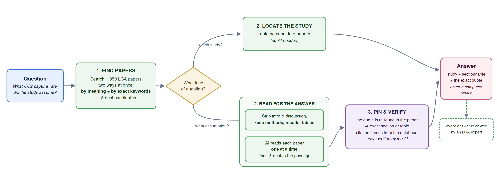

# LLM-LCI

Research code from the 2026 Duke Kunshan University (DKU) Summer Research Scholars
program, provided as-is with no support. The paper corpus is Elsevier full text
under an institutional entitlement, so it and everything built from it are not
included; see [Data availability](#data-availability).

A librarian for life-cycle-assessment papers. Given a question about an inventory
assumption, it points to the study and the section or table that states it, and
quotes the text verbatim. It locates and quotes — it never computes, converts, or
compares numbers.

Two question types are routed differently:

- **TASK1 — "which study contains X?"** answered by retrieval alone (no LLM call).
- **TASK2 — "what assumption was made?"** each candidate paper is fed to a long-context
  reader, one paper per LLM call; the section is then resolved in Python from the
  returned quote.

## How a question flows



*Diagram caveats (the image predates these corrections; fixing it needs a
regenerated image): "8 best candidates" means up to 8 unique papers;
"no AI needed" means no LLM call, but the search still uses the MiniLM
embedding model; "exact section or table" holds only when Python finds the
quote, otherwise the model's own section claim is kept (step 5); and
"every answer reviewed by an LCA expert" is not true of every run — the
`valid?` column is filled only when Prof. Lam reviews a dump.*

1. **Search.** The question is embedded (MiniLM) and searched against 290,247
   chunks two ways at once — dense vectors (ChromaDB) and keywords (BM25) —
   fused with weight α=0.4 on the dense side.
2. **Dedup to papers.** Top chunks collapse to up to 8 unique DOIs (7.7 on
   average): chunks are the retrieval unit, papers are the reading unit.
3. **TASK1 stops here**, returning the top-3 studies (title + DOI).
4. **TASK2 reads.** Each unique paper's body goes to the reader as one call per
   paper, in parallel. The feed is trimmed by default: references stripped;
   Abstract, Introduction, Discussion and Conclusions sections dropped (a heading
   that matches both a KEEP and a DROP rule is kept); extracted tables re-injected —
   never combined, which would invite lost-in-the-middle and cross-paper mixing.
   The reader returns {relevant, location, assumption, supporting_quote}.
5. **Python resolves the location.** The quote is located in the feed by string
   search (on its first 30–120 normalized characters) and the heading above it
   becomes the reported section or table. When Python cannot find the quote, the
   model's own section claim is kept and marked `location_source=model`. DOIs
   always come from the index; the model never writes one.
6. **Aggregate.** Papers answering YES are listed with location and quote.


Run everything from the repo root. Layout: `ingest/` builds the indexes (including
`add_papers.py` for incremental expansion), `eval/` scores and validates, `tools/`
holds diagnostics and `ask.py`, `screening/` and `tables/` prepare the corpus.
`rag.py`, `hybrid.py`, `rerank.py` are libraries; `step3_orchestrate.py` is the
eval entrypoint.

**To ask one question:** `./ask.sh "…"` on the cluster, or
`python tools/ask.py "Which study contains …"` for locate questions (no GPU).
**To add papers:** `python ingest/add_papers.py --xml-dir <folder>`.
Everything operational — install, rebuild, reproduce — is in `RUNBOOK.md`.

## Corpus

Prof. Lam's screened list `paper_list2_2025.csv` (1,965 papers); **1,959**
full-text Elsevier XMLs, downloaded fresh from that list in June. The other 6 are
not 10.1016 DOIs (4× 10.3168/jds, J. Dairy Sci.; 2× 10.1053/j.ajkd) and were
never attempted: the download script keeps only 10.1016 DOIs. Indexed as
**290,247 chunks** = 280,253 prose + 9,994 table records.

A separate, broader WoS-2025 merge downloaded 2,844 XMLs. That set is not the
source of the 1,959 (2,844 − 1,156 = 1,688, not 1,959); it is excluded by design.
The download log sits in the corpus folder as `elsevier_xml/download_log_v2.csv`
(not published, like the corpus); which download run it records is not
documented. Count XMLs with `ls elsevier_xml/*.xml | wc -l` (1,959); a bare
`ls | wc -l` gives 1,960 because of that log file.

## Retrieval evaluation (MiniLM, top-10, hybrid weighted fusion)

Alpha sweep — the **30-question** set (June), not the full 50. The 50-question
figure is the separate line below the table.

| alpha (dense weight)        | Hit@10    | MRR       | Chunk-hit |
|-----------------------------|-----------|-----------|-----------|
| 1.0 (dense-dominant)        | 83.3%     | 0.631     | 30%       |
| 0.5 (old default)           | 93.3%     | 0.631     | 37%       |
| **0.4 (validated, pinned)** | **96.7%** | **0.666** | **40%**   |
| 0.0 (BM25-dominant)         | 90.0%     | 0.617     | 37%       |

alpha weights the dense side; 1-alpha weights BM25. The optimum at 0.4 means exact
terms (material names, software versions) carry slightly more signal than embeddings
on this corpus. With weighted fusion the endpoints are pure methods (α=1 dense
only, α=0 BM25 only) as long as top_k ≤ candidate_k. A June run where α=0 and
α=1 gave identical results came from an empty Chroma store, not from the fusion.
`eval/bm25_eval.py` is a separate keyword-only baseline.
Sweep artifacts: `eval_runs/results_20260623_*_a_*.json` (candidate_k=50; runtime uses
100 — at a=0.5 that shift changes Hit@10 not at all and MRR by +0.014). These JSON
files are in neither the repo nor the author's private archive (checked 2026-10-24);
the archive holds only the 0618/0622 result JSONs.

Full 50-question set (38 assumption + 12 locate), same config: Hit@10 92.0%,
MRR 0.671 (results_20260624_120336_v3.json — also not in the repo or archive,
checked 2026-10-24). `eval/evaluate.py` now defaults to this config
(hybrid, weighted, α=0.4, top-k 10, candidate_k 50).

Within-paper reranking (studied, not deployed): holds Hit@10 at 96.7% while lifting
MRR to 0.681 and chunk-hit to 50% (results_20260623_125314_within_rr.json — not in
the repo or archive, checked 2026-10-24).

End-to-end (Qwen3.5-35B-A3B-FP8 reader, one paper per LLM call, 131K context, L20):
composite gold-in-answer 47/50 = 94% (TASK2 36/38 · TASK1 11/12), zero truncated
feeds, 29.2 s per question (job 29103); answer-match 33/35 (judge job 29269 on
29103's dump). Reader adopted 2026-07-15 — see docs/pipeline.md update logs. Previous reader (Qwen2.5-32B-AWQ, on
an A40): same composite at 139.2 s/question with 45 truncated feeds. Part of that
speedup comes from the A40 → L20 card change.

Provenance of those numbers:
- Composite 47/50 holds in both job 29103 (15 Jul, explicit flags, multi-gold on
  2 questions) and job 31898 (27 Jul, bare defaults, multi-gold on 12 questions).
  The private eval workbook has `valid_dois` on 12 qids, so a bare re-run scores
  with the same multi-gold set as 31898. The current code has not yet been re-run on
  the cluster (RUNBOOK §7).
- Answer-match 33/35 comes from judge job 29269, run on 29103's dump
  (`answers_20260715_074948.xlsx`), not from 29103 itself.
- Section-hit 24/29 (raw) on both the 29103 and the 31898 dumps, recomputed
  offline 2026-10-24 with `eval/audit_locations.py`.
- The run logs and answer dumps behind these numbers are kept in the author's
  private archive (not published: they contain verbatim paper text or licensed
  data).

Earlier v2-era numbers (27 questions, Hit@5 74.1%) are superseded.
Always run evals from the repo root.

## Rebuilding the index (important: wipe first)

ChromaDB **persists to disk** and chunk IDs include a random UUID
(`doi::section::local::uuid`), so re-running `ingest_dir.py` does **NOT**
overwrite existing chunks — it appends new ones with new IDs. Re-ingesting on
top of a non-empty (or partially-built/aborted) collection therefore inflates
the count with orphan chunks that are structurally indistinguishable from real
ones, silently corrupting retrieval and eval. (This applies to PROSE chunks from
`ingest_dir.py`; table records use deterministic IDs and `upsert`, so they are
re-ingest-safe by construction.) Since 2026-10-24 `ingest_dir.py` refuses to
write into a non-empty collection unless `--resume` is given (ERROR, exit 1).

Commands for a full rebuild are in **RUNBOOK.md §3b** (wipe first, then build in
order). Adding a handful of papers instead? Use `ingest/add_papers.py`
(RUNBOOK §6) — it dedupes by DOI, so the wipe rule never applies.

**Clean-build sanity counts** (must match exactly):
- ingest `chunks added`: **280,253**
- `index_tables` `count before`: **280,253** → `count after`: **290,247**
- BM25 indexed: **290,247**

If the post-ingest count is not 280,253 (e.g. 301,405 or 311,399), the
collection was not empty — delete and rebuild.

## Data availability

- **Not included:** the 1,959 Elsevier full-text XMLs (`elsevier_xml/`), the
  tables extracted from them (`tables_xml/`) and the search indexes built from
  them (`chroma_db/`, `bm25_index/`). They are licensed Elsevier content and are
  gitignored.
- **To rebuild them** you need your own Elsevier API key, set in the environment
  variable `ELSEVIER_API_KEY`, and an institutional full-text entitlement
  (IP-based: run from your institution's network). Download with RUNBOOK §3c
  (it reads the shipped `paper_list2_2025.csv`; see the notes there), then
  build with §3b.
- **`paper_list2_2025.csv`** lists the 1,965 DOIs of the corpus, with titles
  from Crossref (columns `DOI`, `Article Title`).
- **Kept in the author's private archive and not published:** the 50-question
  eval set (questions, gold DOIs, expected answers, section locations), the
  expert labels, the answer dumps, judged files and run logs cited in
  `docs/pipeline.md`, and the Web of Science screening exports. The eval
  scripts default to the private workbook `eval/LCA_RAG_eval_set_v3_50.xlsx`
  and stop with an ERROR (exit 1) when it is missing.

## What you can run

Without the corpus, nothing beyond reading the code and the docs.

With your own Elsevier API key and an institutional full-text entitlement you
can rebuild the corpus and indexes (RUNBOOK §3c, §3b), then:

1. **Locate mode, no GPU:**
   `python tools/ask.py "Which study contains the LCI for constructed wetlands for wastewater treatment?"`
2. **Assumption mode.** Needs a GPU running vLLM with the reader model
   (RUNBOOK §3d, §5).
3. **Evaluation, with your own questions file.** Use an `.xlsx` (sheet
   `Questions`) or a `.csv` with columns `id,type,question,source_doi`
   (optional: `valid_dois`, `expected_answer`, `source_location`), passed with
   `--eval-set`. Retrieval eval, no GPU: Hit@10 and MRR use only the gold DOIs;
   chunk-hit needs `expected_answer` and is skipped without it.

   ```
   python eval/evaluate.py --eval-set my_questions.csv --retriever hybrid --fusion weighted --alpha 0.4 --top-k 10 --bm25-dir bm25_index/papers
   ```

   The composite gold-in-answer score needs a GPU (RUNBOOK §7):
   `step3_orchestrate.py` scores against `source_doi` and `valid_dois`.

Exact reproduction of the reported numbers needs the private eval set. It also
needs the WoS titles used in those runs (private archive):
`paper_list2_2025.csv` now carries Crossref titles, which feed the table records
and the judge's STUDY TITLE line.

The section-hit audit (`eval/audit_locations.py`) and the answer-match judge
(`eval/judge_answers.py`) need section locations and expected answers in an
`.xlsx` (`--qfile`): the private workbook or your own. Judge calibration
(`eval/compare_judges.py`) needs the expert labels. Without them these scripts
stop with an ERROR.

## License

The code is released under the MIT License (see `LICENSE`). The license covers
the code only. It does not cover Elsevier content, Web of Science records or any
other third-party data.

## Acknowledgements

- Prof. Ka Leung Lam, Duke Kunshan University: faculty mentor and LCA domain
  expert. He set the project's scope and validated the answers.
- Nizar Talty: earlier classifier benchmarking and the PDF table-extraction
  track.
- Funded by the DKU Office of Academic Services and the DKU Summer Research
  Scholars program.
